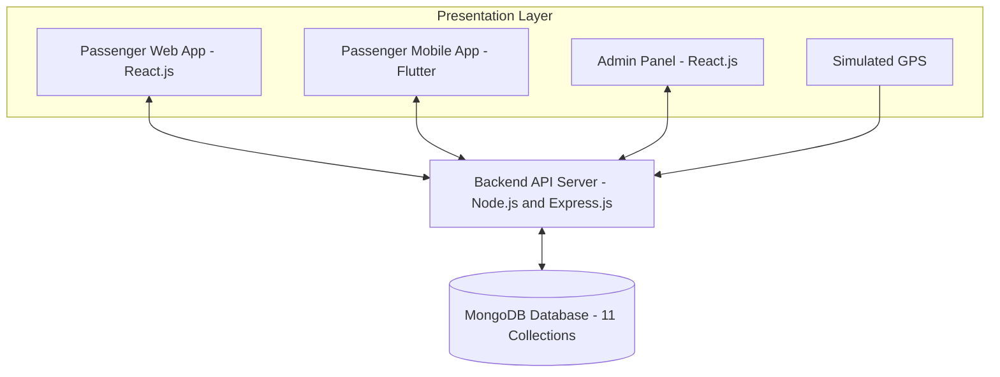

# Government Bus Tracking and Passenger Journey Assistance System

## 1. Project Overview

The Government Bus Tracking and Passenger Journey Assistance System helps passengers search for buses, check routes and timetables, track simulated bus locations, view estimated arrival times (ETA), and find alternative buses.

The system includes:
- Passenger Web Application
- Passenger Mobile Application
- Admin Panel
- Backend/API Server
- MongoDB Database
- Simulated GPS Module

## 2. Problem Statement

Passengers often face difficulties finding bus information, checking schedules, understanding routes, and planning journeys.

This project provides a centralized digital platform for accessing available bus journey information and passenger assistance.

## 3. Project Objectives

1. Provide a user-friendly bus search platform.
2. Display available bus routes and stops.
3. Provide timetable information.
4. Provide simulated GPS-based bus tracking.
5. Display ETA when sufficient journey data is available.
6. Suggest alternative buses when available.
7. Provide passenger registration and login.
8. Provide passenger profile and feedback.
9. Develop a responsive web application.
10. Develop an Android mobile application.
11. Provide an Admin Panel.

## 4. Project Scope and Limitations

### Included Features
- Passenger Web Application
- Passenger Android Application
- Admin Panel
- Bus Search and Bus Details
- Route and Stop Information
- Timetable
- Simulated GPS Tracking
- ETA Calculation
- Alternative Bus Information
- User Authentication
- Passenger Profile
- Notifications
- Feedback Management

### Limitations
- GPS tracking is simulated, not actual MSRTC live tracking.
- GTFS dataset is community-sourced and may be incomplete.
- The project is not officially affiliated with MSRTC.
- Missing bus information, fares, timings, or seat availability will not be fabricated.
- ETA will be displayed only when sufficient journey duration data is available.

## 5. Technology Stack

| Component | Technology |
|---|---|
| Passenger Web | React.js |
| Passenger Mobile | Flutter |
| Admin Panel | React.js |
| Backend | Node.js |
| API Framework | Express.js |
| Database | MongoDB |
| API Communication | REST API |
| Development Tools | VS Code, Antigravity |
| Version Control | Git and GitHub |
| Database Tool | MongoDB Compass |

## 6. System Architecture

The project follows a three-layer architecture.

### Presentation Layer
- Passenger Web Application
- Passenger Mobile Application
- Admin Panel

### Application Layer
- Node.js
- Express.js
- REST APIs
- Authentication
- Bus Search
- GPS Tracking
- ETA Calculation
- Alternative Bus Logic

### Database Layer
- MongoDB
- 11 Collections
- Data Relationships
- Database Validation

### Architecture Diagram

### Working Flow

1. Passenger opens the Web or Mobile Application.
2. Passenger searches for a bus.
3. Frontend sends a request to the Backend API.
4. Backend retrieves information from MongoDB.
5. Simulated GPS provides demo bus coordinates.
6. Backend processes the available data and calculates ETA when possible.
7. Application displays bus information, location, next stop, and ETA.
8. Admin manages system information through the backend.

## 7. Main Project Modules

### A. Passenger Web Application
- Registration and Login
- Passenger Dashboard
- Bus Search
- Bus Details
- Route and Stop Details
- Timetable
- Bus Tracking
- ETA
- Alternative Bus Search
- Passenger Profile
- Notifications
- Feedback

### B. Passenger Mobile Application
- Splash Screen
- Login and Registration
- Passenger Home
- Bus Search
- Bus Details
- Route and Timetable
- Simulated Bus Tracking
- ETA
- Alternative Bus
- Profile
- Notifications
- Feedback

### C. Admin Panel
- Admin Login
- Admin Dashboard
- Bus Management
- Route Management
- Stop Management
- Timetable Management
- User Management
- Feedback Management
- Notification Management

### D. Backend Module
- Express Server
- REST API Development
- Authentication
- Bus Search APIs
- Route and Stop APIs
- Timetable APIs
- GPS Tracking APIs
- ETA Calculation
- Alternative Bus Logic
- Profile and Feedback APIs

## 8. Database Design

MongoDB contains the following 11 planned collections:

| No. | Collection |
|---|---|
| 1 | Users |
| 2 | Drivers |
| 3 | Buses |
| 4 | Routes |
| 5 | Stops |
| 6 | Trips |
| 7 | GPSLocations |
| 8 | Timetables |
| 9 | Breakdowns |
| 10 | Notifications |
| 11 | Feedbacks |

## 9. Team Member Responsibilities

### Member 1 – Team Leader
**Architecture & Integration**

Responsibilities:
- Project Planning
- System Architecture
- Architecture Diagrams
- Data Flow Diagrams
- Working Flow Documentation
- GitHub Repository Management
- Team Coordination
- Frontend and Backend Integration
- Final Integration Testing

Assigned Files:
- README.md
- docs/
- .gitignore
- Root-level configuration files

### Member 2 – Frontend Developer

Responsibilities:
- Passenger Web Application
- Flutter Android Application
- Admin Panel UI
- Responsive Design
- Frontend API Integration

Assigned Folders:
- passenger-web/
- passenger-mobile/
- admin-panel/

### Member 3 – Database Developer

Responsibilities:
- MongoDB Configuration
- 11 Database Models
- Schema Design
- Relationships
- Data Validation
- GTFS Data Migration
- Demo Data Management

Assigned Folders:
- backend/src/config/
- backend/src/models/
- backend/scripts/
- docs/datasets/msrtc-gtfs/

### Member 4 – Backend Developer

Responsibilities:
- Node.js and Express.js
- REST API Development
- Authentication
- Bus Search APIs
- GPS Tracking
- ETA Calculation
- Alternative Bus Logic
- Backend Services

Assigned Files:
- backend/src/app.js
- backend/src/server.js
- backend/src/controllers/
- backend/src/routes/
- backend/src/middlewares/
- backend/src/services/
- backend/src/utils/
- backend/src/data/

### Common Responsibilities

All members will participate in:
- Module Testing
- Integration Testing
- Test Case Preparation
- Documentation Review
- Final Presentation
- Project Demonstration
- Viva Preparation

## 10. Project Development Timeline

| Phase | Planned Work |
|---|---|
| Phase 1 | Requirement Analysis and Project Planning |
| Phase 2 | System Architecture and Database Design |
| Phase 3 | Backend Development and API Testing |
| Phase 4 | Database Implementation and Data Migration |
| Phase 5 | Passenger Web Application |
| Phase 6 | Flutter Android Application |
| Phase 7 | Admin Panel Development |
| Phase 8 | Frontend and Backend Integration |
| Phase 9 | System Testing and Bug Fixing |
| Phase 10 | Documentation, PPT and Final Demonstration |

## 11. GitHub Collaboration Plan

- Create one common GitHub repository.
- Add all team members as collaborators.
- Each member works on assigned files.
- Each member uses an individual GitHub account.
- Create separate feature branches.
- Commit and push individual changes.
- Create Pull Requests for code review.
- Merge verified changes into the main branch.
- Maintain meaningful commit messages.

### Files Not to Be Committed

- .env
- node_modules/
- dist/
- build/
- Local credentials and passwords

## 12. Testing Strategy

### Unit Testing
- Test frontend components.
- Test backend API functions.
- Test database models and validation.

### Integration Testing
- Test frontend and backend communication.
- Test backend and database communication.
- Verify authentication and data flow.

### System Testing
- Test complete passenger journey.
- Test bus search and details.
- Test timetable and simulated tracking.
- Test ETA and alternative bus information.
- Test passenger profile and feedback.

### Compatibility Testing
- Test Web Application on different screen sizes.
- Test Flutter Application on Android devices.
- Test Admin Panel on supported browsers.

## 13. Risk Management

| Risk | Planned Solution |
|---|---|
| Incomplete GTFS Data | Display unavailable data clearly |
| Backend API Errors | API testing and error handling |
| Database Connection Failure | Check MongoDB connection |
| Integration Conflicts | Branch-based GitHub workflow |
| Simulated GPS Limitations | Clearly identify simulated tracking |
| Missing Journey Durations | Do not generate unsupported ETA |
| Device Compatibility Issues | Test on Android devices |

## 14. Expected Project Deliverables

1. Complete Project Source Code
2. Passenger Web Application
3. Passenger Android Application
4. Admin Panel
5. Node.js Backend APIs
6. MongoDB Database with 11 Collections
7. System Architecture Diagram
8. Data Flow Diagram
9. Project Planning Document
10. Test Cases and Testing Report
11. Project Report
12. Presentation PPT
13. GitHub Repository
14. Final Project Demonstration

## 15. Expected Outcome

The expected outcome is a centralized Government Bus Tracking and Passenger Journey Assistance System that provides passengers with convenient access to bus information, journey planning assistance, simulated tracking, and estimated arrival information through Web and Android applications.

The project demonstrates frontend development, backend API integration, database management, software architecture, teamwork, and software testing.
